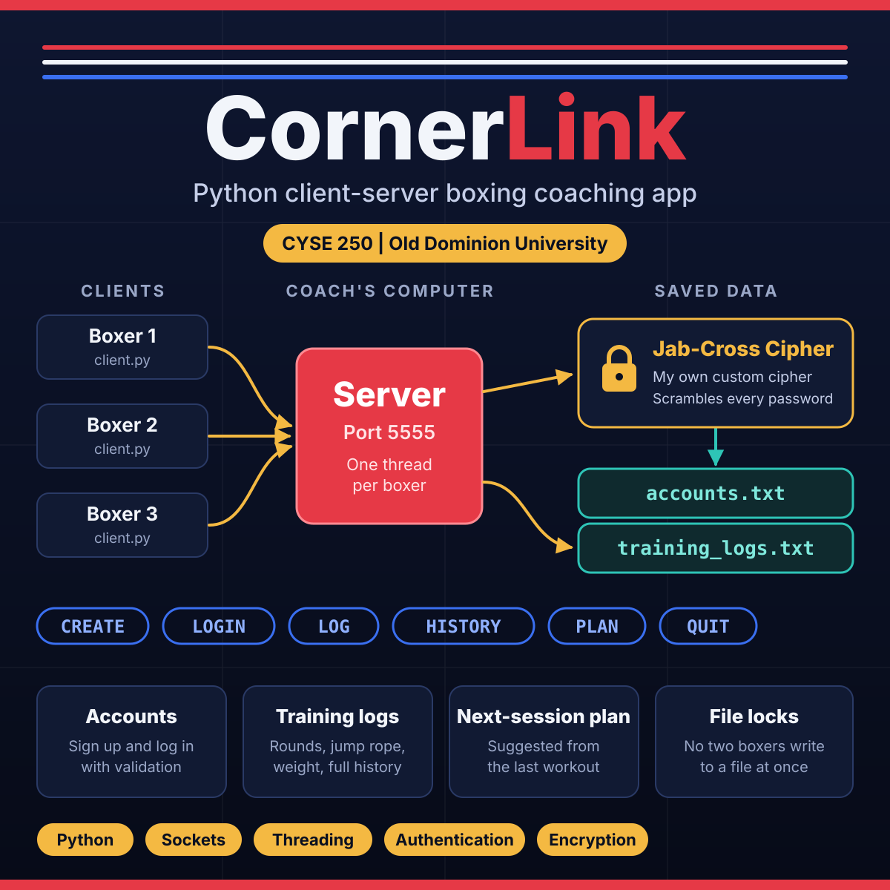
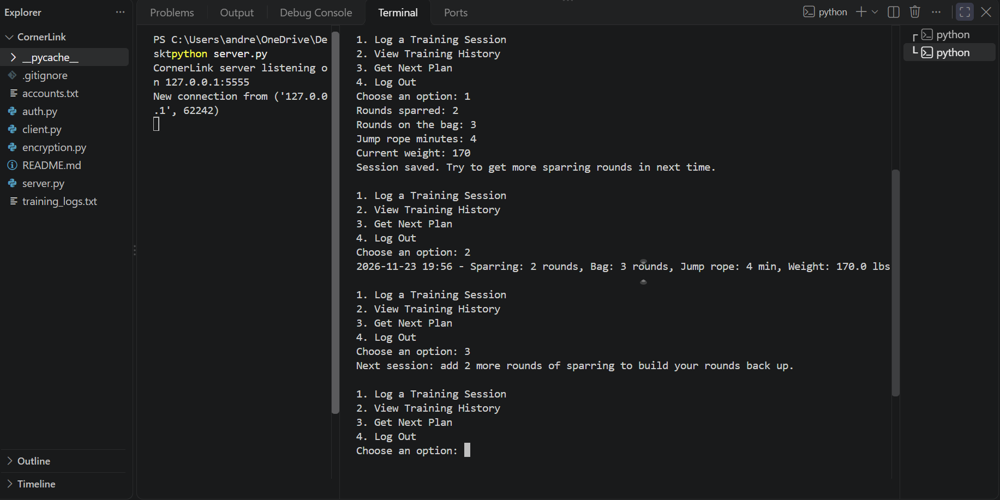

# CornerLink

A boxing coaching app built with Python sockets. Boxers connect to a coach's server, log in, and log their training. This was my final project for CYSE 250 at Old Dominion University.

## Features
- Create an account and log in
- Log a session: rounds sparred, rounds on the bag, jump rope minutes, and weight
- View training history
- Get a plan for the next session
- Handles many boxers at once using threads
- Passwords are encrypted with my own Jab-Cross Cipher before they are saved

## Demo

## Files
- server.py: runs the server
- client.py: the boxer's program
- auth.py: account creation and login
- encryption.py: the Jab-Cross Cipher

## How to run
1. Open two terminals in this folder.
2. In the first one, run: python server.py
3. In the second one, run: python client.py

## Limits
This is a learning project. The cipher is not secure by modern standards, and passwords are only encrypted when saved, not while they travel over the connection. A real app would use TLS and a database.
